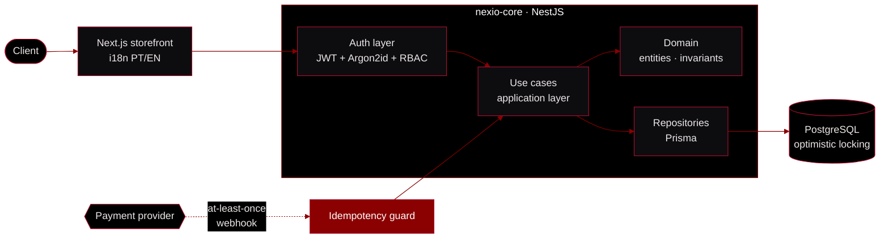

  

  
  
  

I build backends meant for production, not for `localhost`: well-defined API contracts, data that stays consistent under concurrency, automated tests, and continuous delivery. At cVortex I turned manual support workflows into Python automations and worked on LLM integrations (Gemini API, RAG pipeline) that put me in direct contact with what an unreliable system actually costs the people using it.

> [!NOTE]
> Currently focused on backend services that treat LLMs as a dependency like any other: retries, cost awareness, and failure modes that don't take the request down with them.

†&nbsp;&nbsp;&nbsp;&nbsp;†&nbsp;&nbsp;&nbsp;&nbsp;†

<h2>&#8224; &nbsp;<i>I.</i> &nbsp;N E X I O full-stack commerce platform</h2>

An e-commerce monorepo built from scratch, focused on the problems that only show up once money and concurrency are involved.

<b>&#8224; &nbsp;Engineering decisions worth defending</b>

 

| | |
|---|---|
| **Idempotent webhooks** | Provider redelivery never double-charges |
| **Decimal-safe money** | No floating-point arithmetic anywhere on monetary values |
| **Optimistic locking** | Race conditions on stock and orders fail loudly, not silently |
| **Argon2id + JWT** | OWASP 2025 guidance, refresh tokens, role-based access |
| **Clean Architecture · DDD** | Domain isolated from framework and infrastructure |
| **Vitest + GitHub Actions** | Tests and CI gate every push |

> [!TIP]
> **The decision that taught me the most:** treating the payment webhook as *at-least-once* delivery instead of *exactly-once*. The idempotency key fixed the symptom. Understanding the provider's actual guarantee changed how I model every external integration since.

  
  
  

†&nbsp;&nbsp;&nbsp;&nbsp;†&nbsp;&nbsp;&nbsp;&nbsp;†

<h2>&#8224; &nbsp;<i>II.</i> &nbsp;S U P P O R T &nbsp; A U T O M A T I O N &nbsp; &amp; &nbsp; L L M cVortex</h2>

Python automations that removed recurring manual work from the support team (data extraction, reporting, ticket triage), saving hours per month. I also worked on Gemini API integrations and a RAG pipeline over our internal knowledge base: chunking and retrieval strategy, prompt structure, and handling the cases where the model returns nothing useful.

`Proprietary code`. Happy to walk through the architecture and trade-offs in a conversation.

†&nbsp;&nbsp;&nbsp;&nbsp;†&nbsp;&nbsp;&nbsp;&nbsp;†

<h2>&#8224; &nbsp;<i>III.</i> &nbsp;T O - D O &nbsp; A P P FastAPI + React</h2>

First complete full-stack project. FastAPI backend with SQLAlchemy and a layered architecture, React frontend with React Query and optimistic updates, Vitest tests, fully containerized with Docker Compose.

  

†&nbsp;&nbsp;&nbsp;&nbsp;†&nbsp;&nbsp;&nbsp;&nbsp;†

<h2>&#8224; &nbsp;<i>IV.</i> &nbsp;A R S E N A L</h2>

| | |
|:--|:--|
| **Backend** | Node.js · NestJS · TypeScript · Python · FastAPI · REST |
| **Data** | PostgreSQL · Prisma · MongoDB · relational modeling · migrations |
| **AI** | Gemini API · RAG pipelines · prompt design for production use |
| **Infra** | Docker · Compose · GitHub Actions · Linux (WSL2) · Git · Postman |
| **Frontend** | React · Next.js · Tailwind |

<b>&#8224; &nbsp;Building next</b>

 

- Semantic search over the Nexio catalog using embeddings in PostgreSQL
- Observability for Node services: structured logging, health checks, metrics
- Deeper CI/CD: automated build, tests, migrations, and deploy in one pipeline

  <a href="https://linkedin.com/in/m4rcosz">linkedin.com/in/m4rcosz</a>
  &nbsp;&#8224;&nbsp;
  <a href="https://m4rcosz.com">m4rcosz.com</a>
  &nbsp;&#8224;&nbsp;
  <a href="mailto:zmarcos0103@gmail.com">zmarcos0103@gmail.com</a>

  <i>build &#183; ship &#183; automate &#183; repeat</i>

