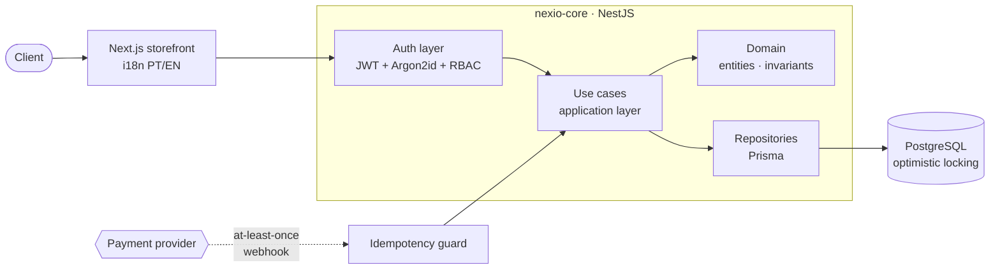

# Marcos — Backend Engineer

Backend engineer focused on production-grade services: well-defined API contracts, data consistency under concurrency, automated testing, and continuous delivery.

At **cVortex**, I replaced manual support workflows with Python automations and worked on LLM integrations (Gemini API, RAG pipeline), which gave me first-hand experience with what unreliable systems cost the people who depend on them.

**Current focus:** backend services that treat LLMs as a regular dependency, with retries, cost awareness, and graceful handling of failure modes.

---

## Featured Work

### Nexio — Full-Stack Commerce Platform

An e-commerce platform built from scratch, focused on the problems that appear once payments and concurrency are involved.

**Key engineering decisions**

| Decision | Outcome |
|---|---|
| Idempotent webhooks | Provider redeliveries never result in duplicate charges |
| Decimal-safe money | No floating-point arithmetic on monetary values |
| Optimistic locking | Stock and order race conditions fail explicitly, not silently |
| Argon2id + JWT | OWASP-aligned hashing, refresh tokens, role-based access control |
| Clean Architecture · DDD | Domain isolated from framework and infrastructure |
| Vitest + GitHub Actions | Tests and CI run on every push |

**Key lesson:** modeling the payment webhook as *at-least-once* rather than *exactly-once* delivery. The idempotency key solved the immediate issue; understanding the provider's actual guarantees changed how I design every external integration since.

[Backend repository](https://github.com/M4rcosz/nexio-core) · [Storefront repository](https://github.com/M4rcosz/nexio-frontend) · [Live demo](https://nexio-frontend-wheat.vercel.app)

### Support Automation & LLM Integration — cVortex

- Built Python automations for data extraction, reporting, and ticket triage, saving the support team hours of manual work each month.
- Integrated the Gemini API and developed a RAG pipeline over the internal knowledge base, covering chunking and retrieval strategy, prompt structure, and fallback handling when the model returns no useful answer.

*Proprietary code — happy to discuss the architecture and trade-offs in conversation.*

### zNuvo — Omnichannel Customer Support SaaS

A multi-tenant support platform where companies connect their channels (an embeddable website chat widget, WhatsApp, Instagram) and their agents answer every conversation from a single real-time dashboard, in Portuguese or English. Currently in active development.

- **Services:** NestJS API, a Go realtime service over WebSockets, a React dashboard and a lightweight Preact widget, all behind a Caddy gateway
- **Messaging and data:** PostgreSQL with separate least-privilege roles, an outbox relay to NATS JetStream, Redis for rate limiting and single-use WebSocket tickets
- **Identity and security:** Zitadel (OIDC + PKCE), customer-signed identity verification, per-key CSP `frame-ancestors` for the widget, strict CSP on the dashboard
- **Features:** conversation routing, agent presence and typing indicators, roles and permissions, invitations, and a contact merge engine with undo
- **Quality:** Vitest with Testcontainers, Go race-detector tests, Playwright end-to-end tests, k6 load tests, OpenTelemetry observability, and a GitHub Actions CI pipeline
- **Architecture:** decisions recorded as ADRs, with Protobuf contracts shared between the TypeScript and Go services

*Private repository — happy to walk through the architecture in conversation.*

---

## Tech Stack

| Area | Technologies |
|:--|:--|
| **Backend** | Node.js · NestJS · TypeScript · Go · Python · FastAPI · REST · WebSockets |
| **Data & Messaging** | PostgreSQL · Prisma · MongoDB · Redis · NATS JetStream · migrations |
| **AI** | Gemini API · RAG pipelines · production prompt design |
| **Infrastructure** | Docker · Docker Compose · GitHub Actions · Linux · Git · Postman |
| **Frontend** | React · Next.js · Tailwind CSS |

## Currently Working On

- Semantic search over the Nexio catalog using embeddings in PostgreSQL
- Observability for Node.js services: structured logging, health checks, and metrics
- End-to-end CI/CD: build, tests, migrations, and deployment in a single pipeline

---

## Contact

[LinkedIn](https://linkedin.com/in/m4rcosz) · [m4rcosz.com](https://m4rcosz.com) · [zmarcos0103@gmail.com](mailto:zmarcos0103@gmail.com)
